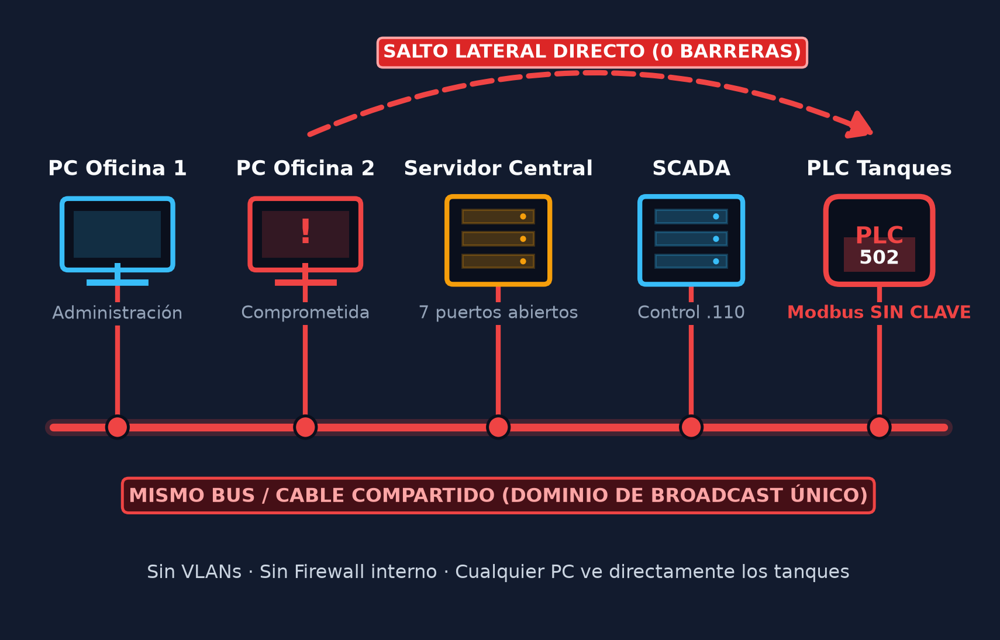
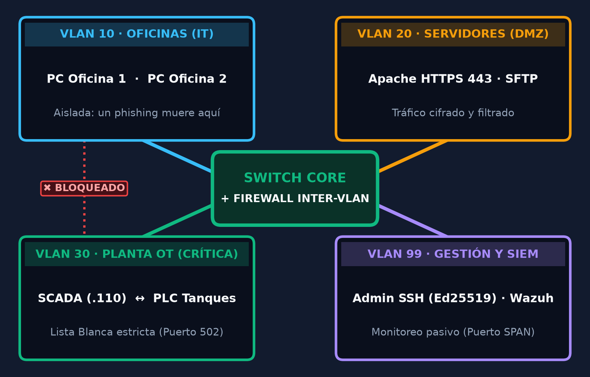
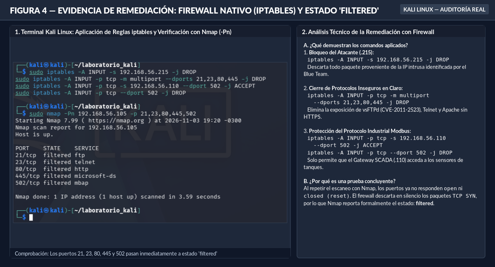

# Auditoría de Ciberseguridad Industrial (OT/IT) — Planta de Despacho YPF

**Autores:** Theo Cervera & Alejandro Módica  
**Comisión:** Comisión 1 — Fundación YPF  
**Docente:** Claudio Pandelo  

---

## Estructura del Repositorio

El repositorio está organizado en tres directorios principales:

| Carpeta | Contenido |
| :--- | :--- |
| **[`informe/`](informe/)** | Trabajo Final completo en formato [`.pdf`](informe/Informe_Auditoria_Ciberseguridad_YPF_Cervera_Modica.pdf) y editable [`.docx`](informe/Informe_Auditoria_Ciberseguridad_YPF_Cervera_Modica.docx). |
| **[`presentacion/`](presentacion/)** | Presentación ejecutiva de defensa oral (11 diapositivas) en [`.pdf`](presentacion/Presentacion_Defensa_Oral_YPF_Cervera_Modica.pdf) y [`.pptx`](presentacion/Presentacion_Defensa_Oral_YPF_Cervera_Modica.pptx). |
| **[`evidencias/`](evidencias/)** | Capturas reales de laboratorio en Kali Linux (Nmap, Wireshark, SearchSploit, exploits, `iptables`), diagramas de red y gráficos de reducción de riesgo. |

---

## Resumen Ejecutivo del Diagnóstico

La auditoría evaluó una **Planta de Despacho** que operaba sobre una **red plana sin segmentación**, compartiendo el mismo dominio de red entre equipos administrativos, servicios de remitos y control industrial (PLC/SCADA).

### Enfoque CVE vs. CWE (Síntoma vs. Causa Raíz)
En lugar de limitarse a parchear vulnerabilidades puntuales (**CVE**), el diagnóstico atacó las tres fallas estructurales de diseño (**CWE**):
1. **`CWE-284` — Control de Acceso Inadecuado:** Red plana donde una PC administrativa comprometida alcanza directamente el puerto `502` (Modbus/TCP) del PLC.
2. **`CWE-319` — Transmisión en Texto Plano:** Credenciales y comandos viajando sin cifrar por `FTP (21)`, `Telnet (23)` y `HTTP (80)`.
3. **`CWE-1104` — Uso de Componentes Obsoletos:** Servicios críticos heredados (`Apache 2.4.49`, `vsftpd 2.3.4`, `MySQL 5.5`, `Samba 3.x`, `OpenSSH`).

### Alcance de Pruebas Controladas (7 Puertos Expuestos)
- **3 vectores validados en entorno controlado:** `Apache 2.4.49` (`80`, Path Traversal), `vsftpd 2.3.4` (`21`, Backdoor) y `OpenSSH` (`22`, `*sshole` / `CVE-2026-123158` sobre capa de aplicación).
- **4 vectores resguardados sin explotación invasiva:** `Telnet (23)`, `Samba (445)`, `MySQL (3306)` y `Modbus/TCP (502)` para preservar la integridad operativa y la seguridad industrial.

---

## Estrategia de Mitigación en Dos Tiempos

### 1. Contención Inmediata — Día 1 (`iptables`, 0 segundos de corte operativo)
- **`DROP` total silencioso** únicamente en puertos sin uso operativo externo: `23` (Telnet), `445` (Samba) y `3306` (MySQL).
- **Lista Blanca (Whitelist) por IP** en puertos operativos:
  - `502` (Modbus/TCP): solo permitido desde la IP del servidor SCADA (`.110`).
  - `21` y `80` (FTP/HTTP): solo permitidos desde las IPs autorizadas de operadores de remitos/facturación, evitando cortar la operación diaria.
- **Riesgo residual documentado:** El puerto `22` (OpenSSH) mantiene exposición de Capa 7 (`*sshole` / `CVE-2026-123158`) mientras permanezca habilitado el acceso remoto sin actualización ni bastionado.

### 2. Remediación Estructural — Parada Técnica Programada
La segmentación definitiva en **4 VLANs (IEC 62443)** y la actualización/reemplazo de servicios heredados acoplados (`Apache`, `FTP`, `MySQL`, `Samba`) **sí requieren una parada técnica programada** para evitar interrupciones imprevistas en remitos y despacho. El plan contempla:
- Preparación previa en paralelo y **laboratorio espejo (staging)** para validar compatibilidad antes del cambio.
- **Ventana de mantenimiento planificada** con **plan de rollback** ante cualquier anomalía.

---

## Arquitectura: Antes vs. Después

| Red Plana Actual (`CWE-284`) | Arquitectura Segmentada en 4 VLANs (IEC 62443) |
| :---: | :---: |
|  |  |

---

## Evidencias Destacadas

### Contención en Caliente con `iptables`

